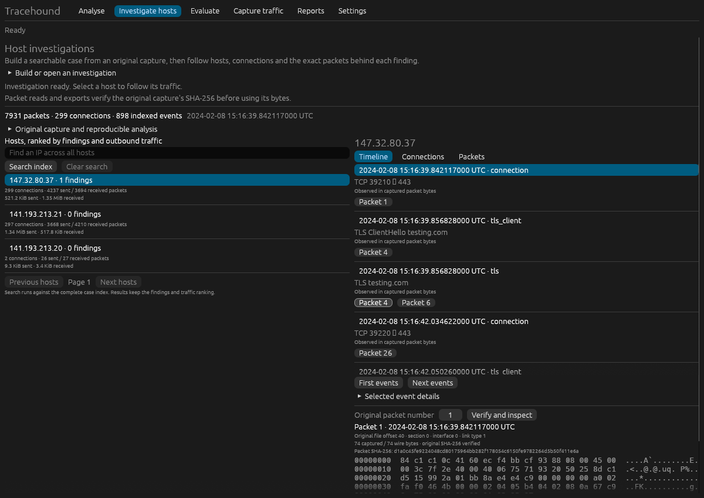

# Tracehound

**Investigate a packet capture. Understand what stands out. Show the packets behind it.**

Tracehound is a desktop app for investigating your own PCAP and PCAPNG files.
Find hosts worth a closer look, understand why traffic was flagged, and export
a case someone else can review. File analysis runs locally on your computer.

**[Download the app](https://github.com/bader-a-tech/tracehound/releases/latest)**
· [First investigation](#your-first-investigation)
· [User guide](docs/investigations.md)
· [Get help](https://github.com/bader-a-tech/tracehound/issues)

[](https://github.com/bader-a-tech/tracehound/actions/workflows/ci.yml)
[](https://github.com/bader-a-tech/tracehound/actions/workflows/evaluate.yml)
[](LICENSE)



*The actual native app investigating a publicly published controlled capture.
Addresses shown belong to that capture. [Screenshot source and reproduction](docs/screenshots/README.md).*

## Download and open

Open the [latest release](https://github.com/bader-a-tech/tracehound/releases/latest)
and choose the installer for your computer. Version numbers appear before the
filename endings below.

| Your computer | Choose the file ending in | Install |
| --- | --- | --- |
| Windows x64 | `windows-amd64-installer-unsigned.msi` | Run the MSI, then open Tracehound from Start |
| Mac with Apple silicon | `darwin-arm64-unsigned.dmg` | Open the DMG and drag Tracehound to Applications |
| Mac with Intel processor | `darwin-amd64-unsigned.dmg` | Open the DMG and drag Tracehound to Applications |
| Ubuntu/Debian, x64 | `linux-amd64.deb` | Install with your package manager, then open Tracehound |
| Ubuntu/Debian, ARM64 | `linux-arm64.deb` | Install with your package manager, then open Tracehound |

Portable ZIP/TAR.GZ bundles are also available. Keep their extracted files together.
Opening an existing capture needs no packet driver, Wireshark installation, or
separate server. Installers are currently unsigned. Check the release's
`SHA256SUMS.txt` and read the [installation guide](docs/release.md) for verification,
platform requirements, and signing status. Linux packages target glibc 2.39 or
newer; macOS packages are built/tested on macOS 15.

## Your first investigation

Bring a PCAP or PCAPNG you are allowed to inspect. No labels or special capture
format are required.

1. **Open a capture.** Launch Tracehound and use **Browse…** on the **Analyse**
   page, or drop the file into the window. **Analyse capture** gives a quick
   findings report.
2. **Investigate a host.** Choose **Investigate this capture**, confirm a new
   investigation file, and click **Create investigation**. Select a host to
   explore its **Timeline**, **Connections**, and **Packets**. You can also
   start from the **Investigate hosts** tab.
3. **Verify and share.** Follow a finding or timeline event to a **Packet N**
   reference, then **Verify and inspect** the original frame. Expand **Export
   this host investigation** to save an HTML/JSON bundle. The HTML opens in a
   browser without Tracehound; including packet bytes is an explicit option.

The app keeps the original capture intact and stores the investigation separately.
Keep both files if you want to inspect the original packets later. Work runs in
the background with progress and cancellation; existing outputs are preserved.

If your capture uses different internal address ranges, set **Settings → Internal
networks** before analysing it. Common private LAN ranges are the default. The
[walkthrough](docs/investigations.md) covers network settings, exports, and
opening selected evidence in an existing Wireshark installation.

## What you can do

| Question | Tracehound helps you inspect |
| --- | --- |
| Which host deserves attention? | Ranked hosts and grouped findings for periodic sessions, DNS tunnelling, scans, large outbound transfers, and unusual TLS fingerprints |
| Why was it flagged? | Timing, payload direction, responses, protocol observations, and the measurements behind each finding |
| What did the host communicate with? | Host timelines, connections, DNS names, TLS handshakes, cleartext HTTP, and observed BitTorrent headers |
| Which packets support the finding? | Original frame references, capture verification, packet previews, and selected-packet export |
| What changed between captures? | Equal-window comparisons of destinations, fingerprints, services, and traffic rates |
| Can someone else review my work? | Standalone HTML, JSON, and optional selected original packets |

Use Tracehound to choose what to investigate, then open the supporting traffic in
Wireshark for deeper protocol inspection. Large cases use a disk-backed index.
Optional live analysis uses an already installed `dumpcap`; optional Windows
socket ownership adds fresh local process context. See the
[capture guide](docs/capture-evaluation.md) for setup and limits.

## Findings need context

A finding identifies a traffic pattern to investigate. It does not prove that a
host is infected. Legitimate peer traffic and scheduled services can be periodic;
encrypted content is not decrypted by the Rust analysis path.

The published independent corpus includes normal traffic, controlled periodic
connections, a malicious sweep, and a DNS tunnel. Version 0.6.1 reduced unique
benign P2P findings from **18 to 6**, while preserving **4/4 reviewed positive
behaviours**. Six benign findings remain in that extended case. This small corpus
does not establish production precision or general malware recall.

Read the [validation results](docs/validation-corpus.md),
[protocol scope](docs/capture-evaluation.md#protocol-and-evidence-scope), and
[resource measurements](docs/performance.md). Reports can contain addresses,
domains, and source paths even when packet bytes are excluded; review them before
sharing. [Capture and reporting policy](SECURITY.md).

## Prefer the command line?

The desktop app and `tracehound-eval` share the Rust engine:

```sh
tracehound-eval analyze /path/to/traffic.pcapng --output report.json
tracehound-eval investigate /path/to/traffic.pcapng --index investigation.thcase
```

On Windows, use `tracehound-eval.exe` from the extracted bundle. See the
[CLI and capture guide](docs/capture-evaluation.md) for options and the
[investigation guide](docs/investigations.md) for timeline, comparison, and export
commands.

<details>
<summary>Build from source</summary>

Use Rust 1.88 or newer for the CLI, Rust 1.95 or newer for the GUI, and a native C
compiler for bundled SQLite. Linux GUI development dependencies are listed in the
[contributor guide](docs/contributing.md).

```sh
cargo build --release --locked --manifest-path tools/capture-eval/Cargo.toml --bin tracehound-eval
cargo build --release --locked --manifest-path tools/capture-eval/Cargo.toml --features gui --bin tracehound-desktop
```

Binaries are in `tools/capture-eval/target/release` (`.exe` on Windows).

</details>

## Help shape the next investigation

Try the tool on a capture you can inspect, and tell us where the workflow becomes
confusing. Useful feedback includes your OS, Tracehound version, the action you
tried, and what happened. Follow the [security policy](SECURITY.md) for sensitive
reports and keep private captures out of public issues.

[Report an issue](https://github.com/bader-a-tech/tracehound/issues)
· [Contribute](CONTRIBUTING.md)
· [Roadmap](docs/roadmap.md)

The next proposed milestone is an evidence-linked **Investigation Brief**: a
clear summary, visual activity timeline, analyst notes, and a sharing preview.
The [roadmap](docs/roadmap.md) separates this planned work from features available
today. Backend and native-app development use Rust or C++.

## Legacy sensor reference

The retained `tracehound` Go executable supports the older embedded dashboard,
Linux AF_PACKET capture, and QUIC Initial fingerprints. Choose it explicitly for
those workflows; coverage differs from the Rust engine. Its commands, API, and
deployment details are in the [compatibility reference](docs/legacy-sensor.md).

<details>
<summary>Generated compatibility sensor output and regression checks</summary>

These deterministic synthetic fixtures test the compatibility engine. The native
app opens your own captures; the independent validation corpus is documented above.
`make readme-samples` regenerates these blocks, and CI checks them against the
actual program output.

### High-severity fixture output

<!-- readmegen:begin replay-high -->

```
[HIGH    ] TH-0002  Probable DNS tunnelling to exfil.example
             2026-03-14T09:12:29Z  10.0.0.66 -> 10.0.0.1:53  score 0.96
             ATT&CK: T1071.004, T1048.003, T1572
             10.0.0.66 issued 46 queries under exfil.example, 100% of them for names never repeated,
             averaging 46 characters of subdomain at 4.53 bits/char entropy. Legitimate resolution reuses
             names and caches; this pattern only makes sense if the name itself is the payload.
             avg_entropy_bits=4.526 avg_subdomain_len=45.783 domain=exfil.example max_subdomain_len=46
             queries=46 queries_per_min=93.404 txt_null_ratio=1 unique_names=46 unique_ratio=1

[HIGH    ] TH-0001  Periodic beaconing to 198.51.100.23:443
             2026-03-14T09:19:26Z  10.0.0.66 -> 198.51.100.23:443  score 0.96
             ATT&CK: T1071.001, T1573
             10.0.0.66 opened 20 connections to 198.51.100.23:443 at a mean interval of 59.1s with 6%
             jitter. Regularity at this level is characteristic of automated check-in rather than user
             activity.
             connections=20 interval_cv=0.057 interval_mad_ratio=0.051 interval_mean_s=59.062
             interval_stddev_s=3.385 jitter_pct=5.731 mean_bytes_to_server=870.222
             periodicity_score=0.949 size_consistency=0.997

[HIGH    ] TH-0003  Port scan: 10.0.0.99 probed 121 ports on 10.0.0.10
             2026-03-14T09:21:11Z  10.0.0.99 -> 10.0.0.10  score 0.56
             ATT&CK: T1046
             10.0.0.99 sent SYNs to 121 distinct ports on 10.0.0.10 within 33s, of which 5 were accepted.
             Enumerating a host's listening services is reconnaissance, not normal client behaviour.
             answered_pct=2.778 duration_s=33.285 open_ports=5 ports_probed=121 scan_type=vertical
             syn_count=180 target=10.0.0.10 targets_total=60

[HIGH    ] TH-0002  Probable DNS tunnelling to exfil.example
             2026-03-14T09:23:13Z  10.0.0.66 -> 10.0.0.1:53  score 0.96
             ATT&CK: T1071.004, T1048.003, T1572
             10.0.0.66 issued 90 queries under exfil.example, 100% of them for names never repeated,
             averaging 46 characters of subdomain at 4.52 bits/char entropy. Legitimate resolution reuses
             names and caches; this pattern only makes sense if the name itself is the payload.
             avg_entropy_bits=4.52 avg_subdomain_len=45.889 domain=exfil.example max_subdomain_len=46
             queries=90 queries_per_min=92.916 txt_null_ratio=1 unique_names=90 unique_ratio=1

[HIGH    ] TH-0001  Periodic beaconing to 198.51.100.23:443
             2026-03-14T09:30:19Z  10.0.0.66 -> 198.51.100.23:443  score 0.96
             ATT&CK: T1071.001, T1573
             10.0.0.66 opened 31 connections to 198.51.100.23:443 at a mean interval of 59.6s with 6%
             jitter. Regularity at this level is characteristic of automated check-in rather than user
             activity.
             connections=31 interval_cv=0.057 interval_mad_ratio=0.046 interval_mean_s=59.639
             interval_stddev_s=3.376 jitter_pct=5.66 mean_bytes_to_server=870.276 periodicity_score=0.954
             size_consistency=0.997
```

<!-- readmegen:end replay-high -->

### Compatibility regression result

<!-- readmegen:begin detection-harness -->

```
    found TH-0001  10.0.0.66 sev=medium score=0.96  Periodic beaconing to 198.51.100.23:443
    found TH-0002  10.0.0.66 sev=high   score=0.96  Probable DNS tunnelling to exfil.example
    found TH-0003  10.0.0.99 sev=high   score=0.56  Port scan: 10.0.0.99 probed 121 ports on 10.0.0.10
    found TH-0004  10.0.0.99 sev=medium score=0.15  Network sweep: 10.0.0.99 probed port 445 across 60 hosts
    found TH-0005  10.0.0.66 sev=medium score=1.00  Large outbound transfer to files.storage-sync.example (17.9 MiB)
    found TH-0007  10.0.0.66 sev=medium score=0.60  Rare TLS fingerprint on 10.0.0.66
--- PASS: TestReplayFindsEveryPlantedBehaviour
    6 benign hosts, none reported above info severity
--- PASS: TestReplayDoesNotAccuseBenignHosts
```

<!-- readmegen:end detection-harness -->

</details>

## License

MIT. See [LICENSE](LICENSE). Release bundles retain upstream copyright and
dependency notices in `licenses/`. Validation captures are downloaded locally;
full PCAP/PCAPNG files are not bundled with releases.
